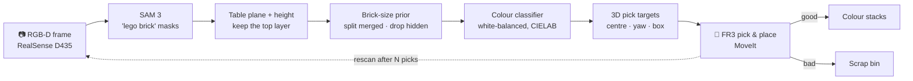

# Vision-Guided Brick Palletizer

A Franka FR3 with a wrist-mounted RealSense D435 that **looks at a stack of bricks, works out which ones it can reach, judges each one, and sorts them**: good bricks onto colour stacks, bad ones into a scrap bin.

Built in six days by Team KalmanKrew at the **robo.innovate Hackathon 2026** (Munich, Track 08 by Marmon). The problem comes from brick manufacturing: after firing, bricks have to be inspected, sorted by shade and palletized. Full-size bricks don't fit on a lab table, so LEGO 2×4 bricks stand in for the robot demo. A separate classifier grades real fired bricks.

## How it works



1. **See.** The wrist camera captures an aligned colour + depth frame from a fixed observation pose.
2. **Find the top layer.** SAM 3 segments every brick. A RANSAC plane fit turns depth into height above the table, so only bricks on the highest layer are kept.
3. **Make it a brick.** Each mask is measured in millimetres on the table plane. Merged bricks are split, and partly hidden ones or side faces are rejected.
4. **Judge.** Colour is measured in CIELAB, using the table as a white reference. Red, dark red and dark orange are **good**; medium nougat and reddish brown are **bad**. A vision-model review (Codex) double-checks each scan.
5. **Act.** Each brick becomes a 3D box in the camera frame. The robot picks a few bricks, places them, returns to the observation pose and rescans until the pile is empty.

**Real bricks.** A separate classifier grades physical fired bricks. It segments them with SAM 3, then fuses colour/texture features and DINOv2 features through two linear SVMs. It graded 9 of the 10 sponsor samples correctly.

## Repository structure

```text
vision-guided-brick-palletizer/
├── fr3_lego_sorter/            ← the robot demo (start here)
│   ├── vision/                 camera pipeline
│   │   ├── data_collection/      D435 RGB-D capture
│   │   ├── perception/           SAM 3 + depth → top-layer bricks + 3D poses
│   │   ├── classifier/           colour model + vision-model review
│   │   └── run_pipeline_classifier.py
│   ├── src/fr3_pose_pick/      ROS 2 package: sorting loop, pick & place, stacks
│   ├── data/calibration/       hand-eye calibration
│   └── README.md               setup, build and run
├── Classify_phy_bricks/        real-brick good/bad classifier (SAM 3 + SVMs)
└── classifier/                 standalone LEGO quality classifier (CPU, from saved detections)
```

## Getting started

| I want to… | Go to |
|---|---|
| Run the full robot sorter | [fr3_lego_sorter/README.md](fr3_lego_sorter/README.md) |
| Understand the method in depth | [fr3_lego_sorter/DOCUMENTATION.md](fr3_lego_sorter/DOCUMENTATION.md) |
| Classify real fired bricks | [Classify_phy_bricks/README.md](Classify_phy_bricks/README.md) |

**Hardware & stack:** Franka Research 3 + Franka Hand · RealSense D435 · ROS 2 Humble + MoveIt 2 · Python · SAM 3 (CUDA GPU)

## Team KalmanKrew

Shiva Rudra Lolla · Varun Teja · Tanay Ranjan · Ameed Nazhurudeen · Ahmet Sinan Erdem
